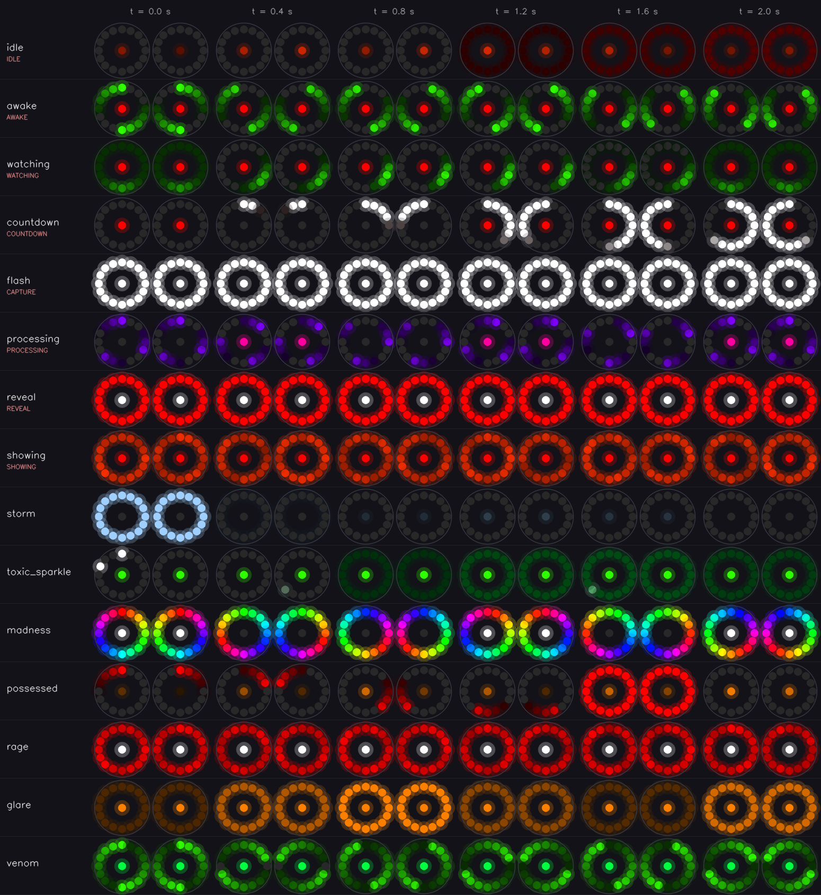
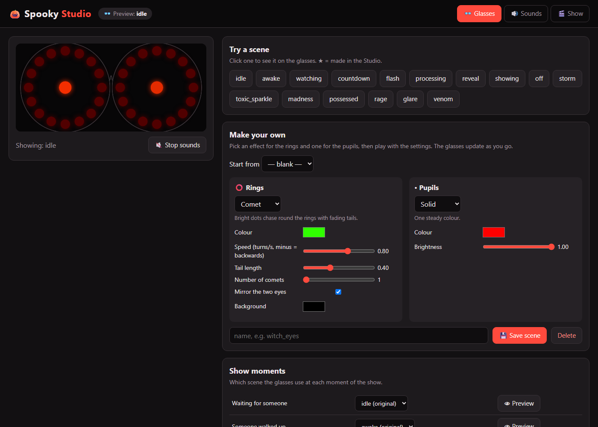
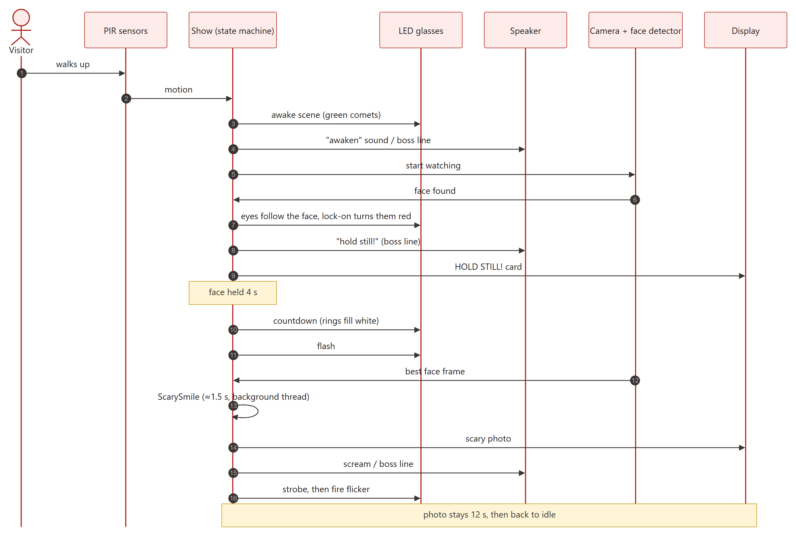
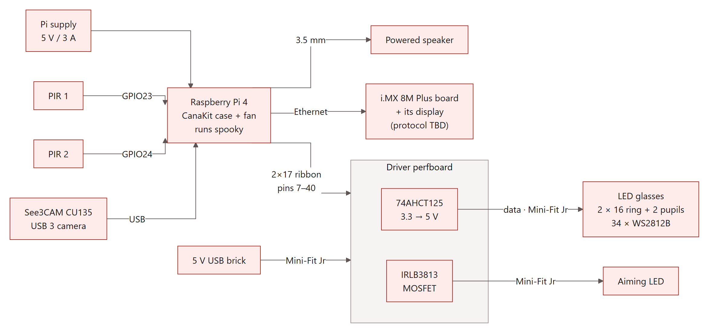
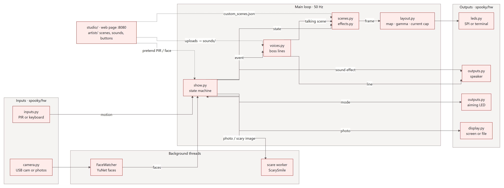
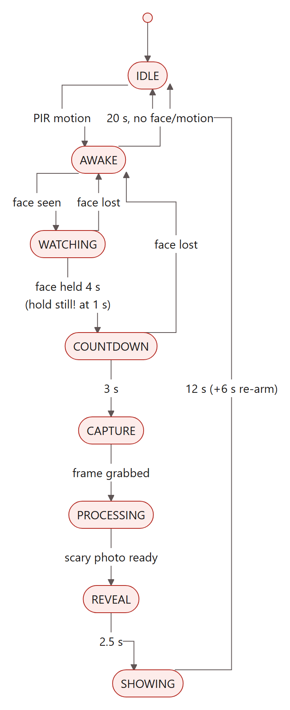
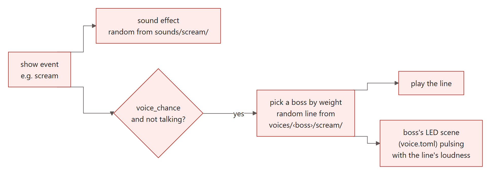
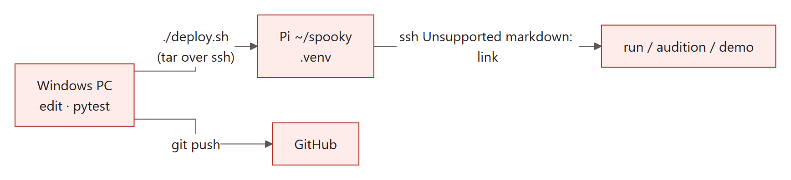

# spooky-pi 🎃

An evil doctor Halloween installation on a Raspberry Pi 4. Walk up and the doctor's LED glasses wake up and follow your face. A countdown runs, the camera snaps you, and a few seconds later you see yourself with a horrible grin, along with a scream and a word from the bosses.

Every LED scene over 2 seconds, rendered by `tools/render_scenes.py` from the same code that drives the glasses. Red labels are the show state that uses each scene.

## 🎨 For artists: Spooky Studio

Play with the glasses, sounds and show from a browser, with nothing to install: **http://spooky-pi.local:8080**. To start it, double-click **Start Spooky Studio** in [`launchers/`](launchers/README.md) (Windows `.cmd`, Mac `.command`).

**[Artist guide →](docs/ARTISTS.md)**: build and save LED scenes with sliders, drop in voice recordings, hear the bosses with talking glasses, and run the show with big buttons.

---

## A visit, start to finish

## Hardware

| Signal | GPIO | Pin | | Power | Source |
|---|---|---|---|---|---|
| LED data (SPI MOSI) | 10 | 19 | | Pi + camera | Pi 5 V / 3 A supply |
| Aiming LED gate | 17 | 11 | | LEDs, aiming LED, PIRs, level shifter | 5 V USB brick |
| PIR 1 / PIR 2 | 23 / 24 | 16 / 18 | | Fan | Pi pins 4/6 |

Wiring, connectors and parts list: **[hardware/BOM.md](hardware/BOM.md)**. The grounds are shared, but the Pi's 5 V never touches the board.

## Software

The rules that hold it together:
- **Everything runs off `Show.step(now)`.** Devices are polled each tick, so tests drive it with a fake clock.
- **Any device can be simulated (`--sim`).** A real device that fails to start is swapped for its stand-in, so the show runs with what works.
- **Animations never touch the wiring.** Effects see "left/right eye, angle, mirrored angle". `layout.py` maps that onto the chain order set in `spooky.toml`.

### Show states

| State | LED scene | Sound event | Aiming LED | Camera |
|---|---|---|---|---|
| IDLE | `idle` | `ambient` every 45–120 s | off | off |
| AWAKE | `awake` | `awaken` | pulse | on |
| WATCHING | `watching`: eyes follow you, turn red as they lock on (4 s) | `spotted`, then `hold_still` at 1 s (display: HOLD STILL!) | on | on |
| COUNTDOWN | `countdown` | `countdown` | blink | on |
| CAPTURE | `flash` | `shutter` | off | on |
| PROCESSING | `processing` | | off | off |
| REVEAL | `reveal` | `scream` | blink | off |
| SHOWING | `showing` | `outro` | off | off |

The timings come from `[show]` in `spooky.toml`. Each LED scene is pictured in the gallery at the top.

 

### Sounds and boss voices

The countdown and flash scenes are never replaced, so visitors always see the timer. Folder layout, file tips and the recording workflow: **[sounds/README.md](sounds/README.md)**.

## How you interact with it

| You want to… | Run (on the Pi, in `~/spooky`, with `.venv/bin/python`) |
|---|---|
| Open the artist Studio | Double-click `launchers/Start Spooky Studio.*`, or on the Pi: `bash scripts/studio-ctl.sh start` (also `stop`, `status`, `log`) |
| Run the show | `python -m spooky` |
| Run it with no hardware | `python -m spooky --sim all` (type `1`/`2` = PIR, `f` = face, `q` = quit) |
| Simulate only some parts | `python -m spooky --sim leds,pir` |
| Preview LED scenes | `python -m spooky.demo [scene …] [--sim] [--brightness 0.1]` |
| Check the sound library | `python -m spooky.audition list` |
| Hear a boss with their LEDs | `python -m spooky.audition play boss_a [--event scream] [--sim]` |
| Replay a state's cues | `python -m spooky.audition state REVEAL --times 3 [--voice boss_b]` |
| Add recordings | `python tools/prep_audio.py raw/*.m4a --voice boss_a --event spotted` |
| Test clips before real ones | `python tools/make_placeholders.py` (`--clean` removes them) |
| Focus the camera | `python tools/focus_view.py`, then open `http://spooky-pi.local:8000` |
| Camera-only check | `python tools/face_trigger.py` |
| Run tests | `python -m pytest` (also works on Windows) |
| Update the README figures | `python tools/render_scenes.py` (LED gallery), `python tools/render_diagrams.py` (diagrams; on a PC with Chrome or Edge) |

| File / folder | What you change there |
|---|---|
| `spooky.toml` | Settings (copy `spooky.example.toml`): LED wiring order, brightness, timings, display |
| `spooky/scenes.py` | Add or tweak LED looks, and pick which scene each state uses |
| `custom_scenes.json` | Scenes and moment choices saved by the Studio (plain JSON, in git) |
| `sounds/<event>/`, `sounds/voices/<boss>/` | Audio clips (not in git) and `voice.toml` per boss |
| `media/idle.jpg` | Optional attract screen between scares |
| `captures/` | Photos taken (on the Pi only, last 50 kept, never committed) |

## Development

- **First time:** run `./deploy.sh --setup` (Git Bash). It creates the venv and installs `requirements.txt`.
- **Python:** 3.11+ locally, 3.13 on the Pi. `spidev`, `gpiozero` and `pygame` come with Raspberry Pi OS.
- **Diagrams:** the source for each diagram is in `docs/diagrams/*.mmd` (Mermaid text). After editing, rerun `tools/render_diagrams.py` and commit the regenerated PNG/SVG in `docs/img/`.
- **Hardware bring-up:** follow the checklist at the bottom of [hardware/BOM.md](hardware/BOM.md). Also add `core_freq_min=500` to `/boot/firmware/config.txt` before the first LED test.
