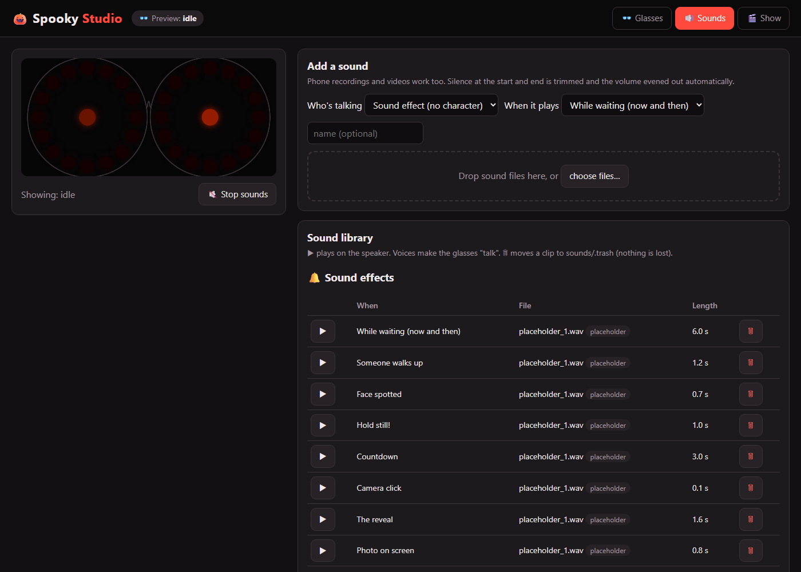
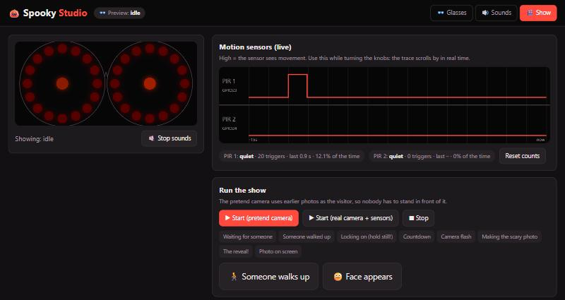

# 🎨 Spooky Studio: a guide for artists

You don't need to install or type anything. Open a web browser on any laptop, tablet or phone on the office Wi-Fi and go to:

## **http://spooky-pi.local:8080**

The picture of the glasses at the top left always shows what the real glasses are doing right now.

> **Page doesn't open?** The Studio isn't running. Double-click **Start Spooky Studio** in the
> [`launchers`](../launchers/README.md) folder (`.cmd` on Windows, `.command` on Mac). It asks for the Pi password and opens the page for you.
> When you're finished, double-click **Stop Spooky Studio** to put the real show back on.
> If `spooky-pi.local` doesn't work on your device, try **http://10.0.3.68:8080**.

---

## 👓 Glasses: make the eyes look evil

| To… | Do this |
|---|---|
| See a look on the glasses | Click its name under **Try a scene** |
| Make your own | Under **Make your own**, pick an effect for the **Rings**, then drag the sliders and pick colours. The glasses change as you go |
| Keep it | Type a name and press **💾 Save scene**. It appears with a ★ |
| Change a saved one | **Start from** → pick it, change it, save with the same name |
| Use it in the show | Under **Show moments**, pick your scene for e.g. *Waiting for someone* |
| Undo a show moment | Pick the one marked *(original)* |

**Effects to play with:**

| Effect | What it looks like |
|---|---|
| Solid | One steady colour |
| Breathe | Slowly glows brighter and dimmer |
| Comet | Dots chasing round the rings (try 2–3 comets, mirror on) |
| Fill | Rings fill up from the top |
| Strobe | Flashing |
| Flicker | Fire or candle |
| Sparkle | Random twinkles |
| Lightning | Dark, then sudden flashes |
| Rainbow | All the colours |
| Off | Dark |

Built-in looks can't be changed or deleted, so you can't break anything. Save your own version instead.

---

## 🔊 Sounds: give the bosses a voice

1. **Who's talking:** pick a character, or *Sound effect* for laughs, screams and bangs.
2. **When it plays:** pick the moment, e.g. *Hold still!* or *The reveal*.
3. **Drop the file** on the dashed box. Phone voice memos, MP3s and even videos work. Silence is trimmed and the volume evened out for you.
4. Press **▶** to hear it on the speaker. When a character talks, **the glasses pulse with their voice**.

| Good to know | |
|---|---|
| 🗑 | Moves a clip to a trash folder; nothing is really deleted |
| *placeholder* | A fake test sound. Delete it once there's a real one for that moment |
| *quiet* / *too loud* | Re-record or trim that clip |
| Length | Keep lines short: 1–4 seconds. The countdown is 3 seconds |
| Characters | Each one has a **Glasses look** while talking, **What talks** (the rings, or nothing), and **How often** they're picked compared to the others |

**The moments, in order:**

| Moment | What's happening |
|---|---|
| While waiting | Nobody around. Plays now and then |
| Someone walks up | Camera sees a face for half a second |
| Face spotted | Camera finds a face; the eyes follow it |
| Hold still! | 1 second into the lock-on (2 s, then the 3-second countdown) |
| Countdown | 3-second countdown to the photo |
| Camera click | Photo taken |
| The reveal | Scary photo appears |
| Photo on screen | While before and after stay up side by side (15 s) |

---

## 🎬 Show: try the whole thing

1. **▶ Start (pretend camera)**, which uses earlier photos so nobody has to stand there, or **▶ Start (real camera)**: then just stand in front of it.
2. With the pretend camera: **🚶 Someone walks up** wakes the show, and **🙂 Face appears** runs the lock-on, countdown, snap, before/after and scream.
3. The highlighted step shows where the show is. **What the screen shows** is the visitor's view.
4. **■ Stop** when you're done (you need to stop the show to preview scenes again).

Your saved scenes and moment choices are used by the real show next time it starts.
