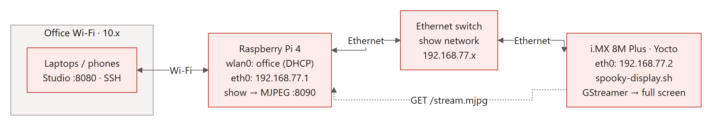

# i.MX 8M Plus display setup

The i.MX shows whatever the show puts on screen: the attract card, **HOLD STILL!**, then the scary photo. The Pi serves it as an MJPEG stream (a stream of JPEG frames); the i.MX pulls it and shows it full-screen with GStreamer.



| | Pi | i.MX 8M Plus |
|---|---|---|
| Show network address | `192.168.77.1` (set by `scripts/pi-setup.sh`) | `192.168.77.2` (this folder) |
| What it runs | the show, serving `:8090` | `spooky-display.sh` (GStreamer loop) |
| Office Wi-Fi | stays on, for the Studio and SSH | not needed |

**Pi endpoints** (also handy for testing from a laptop on the switch):

| URL | What |
|---|---|
| `http://192.168.77.1:8090/stream.mjpg` | the live stream (new picture on every change, repeated every second) |
| `http://192.168.77.1:8090/frame.jpg` | the current picture |
| `http://192.168.77.1:8090/` | full-screen viewer page, if the image has a browser |

## Setup (once, as root on the i.MX)

1. **Fixed address on the show network** (systemd-networkd images):
   ```sh
   cp 10-spooky.network /etc/systemd/network/ && systemctl restart systemd-networkd
   ping -c 3 192.168.77.1
   ```
   For a quick test without changing config: `ip addr add 192.168.77.2/24 dev eth0`. On ConnMan or NetworkManager images, set the same static address there.
2. **Check that the image has what it needs:**
   ```sh
   gst-inspect-1.0 multipartdemux jpegdec | grep -i "^Factory Details" -A1
   gst-inspect-1.0 souphttpsrc >/dev/null && echo "souphttpsrc ok" || command -v curl
   ls /run/user/*/wayland-* 2>/dev/null   # a Weston desktop? then waylandsink is used
   ```
   It needs `multipartdemux` and `jpegdec` (gst-plugins-good), plus either `souphttpsrc` or `curl`.
3. **Try it by hand** (with the show or Studio show running on the Pi):
   ```sh
   sh spooky-display.sh
   ```
4. **Start at boot:**
   ```sh
   cp spooky-display.sh /usr/bin/ && chmod +x /usr/bin/spooky-display.sh
   cp spooky-display.service /etc/systemd/system/
   systemctl daemon-reload && systemctl enable --now spooky-display
   ```
   Check `XDG_RUNTIME_DIR` and `WAYLAND_DISPLAY` in the service file match step 2's output. With no Weston, uncomment `SPOOKY_SINK=kmssink`.

**Behaviour:**
- **Start order doesn't matter:** the script retries every 2 s until the Pi is reachable, and reconnects after any Pi or show restart.
- **Picture size:** the Pi sends pictures already sized for the screen (`display.size` in `spooky.toml`, default 1920×1080). For a portrait screen, set `size = [1080, 1920]` on the Pi.
