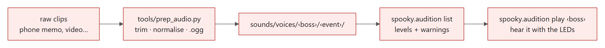

# Sounds

```
sounds/
├── ambient/  awaken/  spotted/  hold_still/  countdown/  shutter/  scream/  outro/   ← sound effects, one random file per event
└── voices/
    ├── boss_a/
    │   ├── voice.toml          ← this boss's LED look
    │   ├── spotted/*.ogg       ← lines, same event names as above
    │   └── scream/*.ogg
    └── boss_b/ …
```

Audio files are **not committed to git**, only the folders and `voice.toml`. Share recordings some other way.

| Event | When | Boss line chance* |
|---|---|---|
| `ambient` | idle, every 45–120 s | 100 % |
| `awaken` | a face wakes the show | 70 % |
| `spotted` | face found, eyes start following | 80 % |
| `hold_still` | 1 s into the 2 s lock-on: "Hold still!" | 100 % |
| `countdown` | photo countdown (keep under 3 s) | 0 % |
| `shutter` | photo taken | 0 % |
| `scream` | scary photo appears | 60 % |
| `outro` | before and after on screen | 80 % |

<sub>*`audio.voice_chance` in `spooky.toml`. A boss never talks over themself, and the effect sound for the event still plays.</sub>

## voice.toml

```toml
scene  = "rage"     # LED scene while this boss talks: any name in spooky/scenes.py
talk   = "rings"    # what pulses with the voice: rings | pupils | all | none (no pupil LEDs: pupils = rings)
weight = 1.0        # how often this boss is picked vs the other
```

## Adding recordings



```
python tools/prep_audio.py raw/coffee.m4a --voice boss_a --event spotted
python tools/prep_audio.py raw/long_rant.mp3 --voice boss_b --event scream --start 4.2 --end 6.0 --name you_did_what
python -m spooky.audition list
python -m spooky.audition play boss_b --event scream
```

**Tips:**
- **Length:** keep lines to about 1–4 s. Ambient lines can be longer.
- **Loudness:** `prep_audio.py` evens it out across clips. `audition list` flags clips that are quiet or clipping.
- **Rename the bosses:** rename the `boss_a` / `boss_b` folders to whatever you like. The folder name is the voice name.
- **Placeholders:** `tools/make_placeholders.py` fills every folder with synthetic test clips; `--clean` removes them again.
